# State map of a search

This folder holds a checked model of one HNTD search, from the form to the shortlist, and two
charts drawn from it. The model is TLA+ (`SearchLifecycle.tla`). TLC explores every reachable
state and reports the shortest path to each state that breaks a rule.

The charts use the words on the dashboard: a search is in queue (`pending`), processing,
completed or failed.

## The charts

**One pipeline run** (`one-run.cfg`, `view.mjs`): the whole life of a search.
Source [`lifecycle.mmd`](lifecycle.mmd), report [`lifecycle.report.md`](lifecycle.report.md).


**Two pipeline runs on one search** (`race.cfg`, `view-race.mjs`): you start the search and walk
away, and two runs want it. One gets the claim.
Source [`two-runs.mmd`](two-runs.mmd), report [`two-runs.report.md`](two-runs.report.md).



**Two runs and the watchdog** (`watchdog.cfg`, `view.mjs`): every action enabled, including the
watchdog's requeue and a reset while a run is still alive.
Source [`watchdog.mmd`](watchdog.mmd), report [`watchdog.report.md`](watchdog.report.md).



A red state breaks a rule. A blue border marks the shortest path to it. No chart has a red state
left: in every configuration, every rule holds.

## The rules

| Rule | In plain words | Result |
|---|---|---|
| `NoResultsForDeletedSearch` | A deleted search leaves no shortlist behind. | Holds since `tasks.completeTask` |
| `CompletedHasResults` | A search shown as completed has a shortlist. | Holds since `tasks.completeTask` |
| `DeliveredStaysCompleted` | Once a shortlist is delivered, the search stays completed until you reset or delete it. | Holds: a run writes only while the search is processing under its claim |
| `OneWriterPerClaim` | Under one claim, the writes of only one pipeline run land on a search. | Holds since every pipeline write carries the claim token. Breaks in `no-token.cfg`, as it must |
| `NoDeadlock` | No state is a dead end, apart from a deleted search. | Holds |

## The five breaks, all fixed

Each path was replayed against the running app on 2026-11-19, first at commit `264045c` and
again at `eb9d2b0` (`replay.txt` under `test-results/verify/`, a local folder).

The model describes the backend, which accepts a run's writes only while that run holds the
claim. Since `eb9d2b0` the local worker (`scripts/local/worker.py`) claims a search when it picks
it and marks an unfinished one `failed` when its run ends, so in local mode the state
`Processing, the run that holds it is gone` lasts only until the worker notices. In the model the
worker and a run started by hand are the same actor: whoever holds the claim.

1. **A deleted search leaves a shortlist behind.** Fixed. `complete-task` used to store the
   result list without checking that the search existed, then fail on the status write.
   `tasks.completeTask` now does both in one transaction and answers HTTP 404 for a search that
   is gone. Nothing is stored.
2. **Completed, with no shortlist.** Fixed. A reset could land between the two writes of
   `complete-task`, or between it and the second status write of `push_results.py`. There is
   one write now, and `update-task-status` can no longer set `completed` at all (HTTP 400).
3. **Failed after it had completed.** Fixed. Two runs read the same queued search, the first
   delivered the shortlist, and the second reported a failure that the backend accepted.
   A run now writes only while the search is processing under its own claim, so the late write
   gets HTTP 409 `claim_lost`. The model has the same rule and TLC lists
   `DeliveredStaysCompleted` under "Rules that hold".
4. **Two runs on one search.** Fixed for the queue. A run used to read the queue and mark the
   search processing much later, and a second `processing` write was accepted. `tasks.claimTask`
   now takes the search with one compare-and-set, `pending` to `processing`, and
   `update-task-status` can no longer set `processing` (HTTP 400). The worker claims when it
   picks a search and hands its claim token to its run (`HNTD_CLAIM_ID`); a run started by hand
   claims in phase 1 and stops when refused.
5. **Two runs write to one search after a requeue.** Fixed (issue #18). The watchdog requeues a
   search after 30 minutes in `processing`, and you can reset it, while its run is still alive.
   A second run then claimed it, and the writes of both landed: replayed on 2026-11-20, the old
   run's pass results and `complete-task` were accepted after the second run's claim. Now the
   claim stores a token on the search (`claimId`), every pipeline write (`update-task-status`,
   `update-jd-profile`, `update-pass-results`, `complete-task`) carries it, and the backend
   answers HTTP 409 `claim_lost` when it is no longer the token on the search. The requeue and
   the reset clear it. The old run stops at its next write, so two runs can still be alive for a
   while, but only one run's writes land. `no-token.cfg` is the same model with the token check
   off (`CheckToken = FALSE`). TLC must find the issue's path there
   ([`no-token.report.md`](no-token.report.md)): start, claim, requeue, a second claim, and the
   first run's write lands. If it stops finding it, `OneWriterPerClaim` no longer detects the bug.

The watchdog still requeues by time only. It does not extend the deadline while a run keeps
writing: the claimed writes come at the claim, after JD parsing, after each pass and at the
end, so a long scoring phase has no write to extend it with.

## What the model leaves out

- One search only. Searches do not interact, apart from the plan quota, which local mode does
  not enforce (the local user is on the unlimited plan).
- The phases inside a run. A run is idle or working, and any of its progress writes (JD profile,
  pass results) is one step, `RunWrites`. Scoring batches are not modelled.
- A retried write after a lost response. The backend answers a repeated `failed` or
  `complete-task` with the same token as done, without a second result list.
- The admin page's reset (`tasks.resetTask`), which requeues without deleting the old shortlist.
- The priority flag, the candidate pipeline and the talent pool.
- Time. The watchdog can requeue any processing search, where the real one waits 30 minutes.

## What the charts hide

- The lifecycle chart draws `you delete the search` only from `Processing`. You can delete from
  every state, and the other deletes all end in `Deleted`.
- The two-runs chart has no delete, no reset, no watchdog and no session that dies. Its model
  (`NextRace`) is a subset of the full one. The watchdog chart uses the full one.
- Steps that do not change a label are not drawn, for example a second run reading the queue
  while the first one works.

## Make the files again

```sh
STATECHART=<pstack plugin>/skills/statechart/scripts/statechart
$STATECHART SearchLifecycle.tla --config one-run.cfg --view view.mjs --out /tmp/hntd-lifecycle
$STATECHART SearchLifecycle.tla --config race.cfg --view view-race.mjs --out /tmp/hntd-two-runs
$STATECHART SearchLifecycle.tla --config watchdog.cfg --view view.mjs --out /tmp/hntd-watchdog
$STATECHART SearchLifecycle.tla --config no-token.cfg --view view.mjs --out /tmp/hntd-no-token  # must break
```

`--out` must be a new or empty folder. The command needs `mise`, or `TLA2TOOLS` set to a
`tla2tools.jar` (v1.7.4) and `JAVA` set to a Java 11 or later. Copy `chart.mmd` and `report.md`
back here under the names above, and render each `.mmd` to `.svg` with `pele@1.9.0`. For
`no-token.cfg`, copy only `report.md`, as `no-token.report.md`.

Update the model when `convex/tasks.ts`, `convex/taskTransitions.ts`, `convex/taskResults.ts`,
the task routes in `convex/http.ts`, or the status calls in `skill/skills/github-hr-run/SKILL.md`
change.
