# State map of a search

This folder holds a checked model of one HNTD search, from the form to the shortlist, and two
charts drawn from it. The model is TLA+ (`SearchLifecycle.tla`). TLC explores every reachable
state and reports the shortest path to each state that breaks a rule.

The charts use the words on the dashboard: a search is in queue (`pending`), processing,
completed or failed.

## The charts

**One pipeline run** (`one-run.cfg`, `view.mjs`): the whole life of a search.
Source [`lifecycle.mmd`](lifecycle.mmd), report [`lifecycle.report.md`](lifecycle.report.md).



**Two pipeline runs on one search** (`race.cfg`, `view-race.mjs`): you start the search and walk
away, and two runs pick it up.
Source [`two-runs.mmd`](two-runs.mmd), report [`two-runs.report.md`](two-runs.report.md).


A red state breaks a rule. A blue border marks the shortest path to it. The lifecycle chart has
no red state left: with one run, every rule holds.

## The rules

| Rule | In plain words | Result |
|---|---|---|
| `NoResultsForDeletedSearch` | A deleted search leaves no shortlist behind. | Holds since `tasks.completeTask` |
| `CompletedHasResults` | A search shown as completed has a shortlist. | Holds since `tasks.completeTask` |
| `DeliveredStaysCompleted` | Once a shortlist is delivered, the search stays completed until you reset or delete it. | Holds since the transition table (`convex/taskTransitions.ts`) |
| `OneRunAtATime` | At most one pipeline run works on a search. | Breaks with two runs |
| `NoDeadlock` | No state is a dead end, apart from a deleted search. | Holds |

## The four breaks, and which are fixed

Each path was replayed against the running app on 2026-11-19, first at commit `264045c` and
again at `eb9d2b0` (`replay.txt` under `test-results/verify/`, a local folder).

The model describes the backend, which accepts these writes from any pipeline run. Since
`eb9d2b0` the local worker (`scripts/local/worker.py`) marks a search `processing` when it picks
it and marks an unfinished one `failed` when its run ends, so in local mode the state
`Processing, no pipeline run alive` lasts only until the worker notices. The model does not
have the worker as an actor yet.

1. **A deleted search leaves a shortlist behind.** Fixed. `complete-task` used to store the
   result list without checking that the search existed, then fail on the status write.
   `tasks.completeTask` now does both in one transaction and answers HTTP 404 for a search that
   is gone. Nothing is stored.
2. **Completed, with no shortlist.** Fixed. A reset could land between the two writes of
   `complete-task`, or between it and the second status write of `push_results.py`. There is
   one write now, and `update-task-status` can no longer set `completed` at all (HTTP 400).
3. **Failed after it had completed.** Fixed. Two runs read the same queued search, the first
   delivered the shortlist, and the second reported a failure that the backend accepted.
   `convex/taskTransitions.ts` now refuses every change out of `completed` except `completed`
   itself, and the late write gets HTTP 409. The model has the same rule and TLC lists
   `DeliveredStaysCompleted` under "Rules that hold".
4. **Two runs on one search.** A run reads the queue in phase 1 and marks the search processing
   only in phase 3.1, after JD parsing and strategy generation. Until then the search still
   looks queued, so a second `/github-hr run` reads it too. The second `processing` write is
   accepted. Replay: `race.txt`. In the model both runs then search and score the same search.

## What the model leaves out

- One search only. Searches do not interact, apart from the plan quota, which local mode does
  not enforce (the local user is on the unlimited plan).
- The phases inside a run. A run is idle, has read the queue, works, or has stored its
  shortlist. JD parsing, pass 2 and scoring batches are not modelled.
- The admin page's reset (`tasks.resetTask`), which requeues without deleting the old shortlist.
- `/github-hr run --task <ID>` on a search that is not in the queue.
- The priority flag, the candidate pipeline and the talent pool.
- Time. The watchdog can requeue any processing search, where the real one waits 30 minutes.

## What the charts hide

- The lifecycle chart draws `you delete the search` only from `Processing`. You can delete from
  every state, and the other deletes all end in `Deleted`.
- The two-runs chart has no delete, no reset, no watchdog and no session that dies. Its model
  (`NextRace`) is a subset of the full one, so each break it shows is a break of the full model.
- Steps that do not change a label are not drawn, for example a second run reading the queue
  while the first one works.

## Make the files again

```sh
STATECHART=<pstack plugin>/skills/statechart/scripts/statechart
$STATECHART SearchLifecycle.tla --config one-run.cfg --view view.mjs --out /tmp/hntd-lifecycle
$STATECHART SearchLifecycle.tla --config race.cfg --view view-race.mjs --out /tmp/hntd-two-runs
```

`--out` must be a new or empty folder. The command needs `mise`, or `TLA2TOOLS` set to a
`tla2tools.jar` (v1.7.4) and `JAVA` set to a Java 11 or later. Copy `chart.mmd` and `report.md`
back here under the names above, and render each `.mmd` to `.svg` with `pele@1.9.0`.

Update the model when `convex/tasks.ts`, `convex/taskResults.ts`, the task routes in
`convex/http.ts`, or the status calls in `skill/skills/github-hr-run/SKILL.md` change.
