<p align="center">
  <picture>
    <source media="(prefers-color-scheme: dark)" srcset=".github/assets/hero-dark.svg">
    <source media="(prefers-color-scheme: light)" srcset=".github/assets/hero-light.svg">
    
  </picture>
</p>

<h3 align="center">Hire from the code, not the CV.</h3>

<p align="center">
  <a href="LICENSE"></a>
  
  
  
  
</p>

HNTD finds developers on GitHub and ranks them by the code they actually wrote. You describe the
role. HNTD searches public GitHub profiles, reads their repositories with your own Claude, scores
each one, and shows a ranked shortlist in a live dashboard. This repository runs the whole thing on
your machine. A hosted version runs at [hntd.it](https://hntd.it).

## Why

- **Code is the evidence.** A CV says what someone claims. Their repositories show how they work.
- **The best people are often invisible.** Many strong engineers have no LinkedIn presence, but
  their work is public on GitHub.
- **Your data stays yours.** Searches, shortlists and scores live in a database on your machine.

<p align="center">
  <picture>
    <source media="(prefers-color-scheme: dark)" srcset=".github/assets/flow-dark.svg">
    <source media="(prefers-color-scheme: light)" srcset=".github/assets/flow-light.svg">
    
  </picture>
</p>

## Quickstart

You need Node.js 20 or later, npm, git, openssl and Python 3. To run searches you also need the
[GitHub CLI](https://cli.github.com) (`gh`) and [Claude Code](https://claude.com/claude-code)
(`claude`), signed in. `gh` does not need a login: the pipeline uses a token you save for it
(see below).

```bash
git clone https://github.com/uppifyagency/HNTD-OpenSource.git
cd HNTD-OpenSource
npm ci
scripts/local/setup.sh
npm run local
```

Open the link `npm run local` prints, `http://127.0.0.1:3000/api/local-session?key=…`. It gives
your browser a key, kept in a cookie, and opens the dashboard. Do this once per browser; after that
<http://127.0.0.1:3000/dashboard> works. Without the key the dashboard says to open the link. To use
another port, run `PORT=3001 npm run local`.

`scripts/local/setup.sh` is safe to rerun. It creates `.env.local`, a signing key for the local
session, a local Convex database, `skill/scripts/.env` for the pipeline, and a Python virtual
environment in `skill/scripts/.venv`. It refuses to overwrite an `.env.local` that is not a
local-mode file, or a `skill/scripts/.env` that points off this machine. `npm run local` starts the database and the app, and
binds the app to `127.0.0.1` only, and starts the pipeline worker. Press Ctrl-C to stop all three.

### Connect GitHub

The pipeline reaches GitHub through `gh` with a token you save for it, never with your own `gh`
login. Any token GitHub accepts works: a classic token or a fine-grained one. The recommended one
is a classic token with no boxes ticked, from <https://github.com/settings/tokens/new>. With no
scopes it can only read public data, which is all the pipeline needs. `setup.sh` asks for a token
once, even when `gh` is signed in. You can also skip the question and paste the token later in the
dashboard, which shows "GitHub non collegato" until the pipeline has a token GitHub accepts. Either
way the token is checked with GitHub and saved as `GH_TOKEN` in `skill/scripts/.env`, which is
gitignored and readable only by you. `setup.sh`, the app and the worker never print it. A command
in a pipeline run can print it, and the run log records every command's output: the log is readable
only by you, and when the run ends the worker replaces every copy of the token in it with
`[GH_TOKEN]`. A copy the command changed (encoded, split) stays. A saved token that GitHub rejects
stops the pipeline, and the dashboard says why.

A classic token with scopes, or any fine-grained token, is accepted with a warning in `setup.sh`,
the worker log and the dashboard. The pipeline reads untrusted text, and an instruction hidden in
it could use such a token to change things on GitHub, within what its scopes or permissions allow.
GitHub shows a classic token's scopes in its API answers, but no API shows a fine-grained token's
permissions, so HNTD cannot tell whether a fine-grained token can write.

### Run a search (beta)

> [!WARNING]
> The search pipeline is in beta. It runs in production on the hosted version, but nobody has
> run it end to end in local mode yet. Expect rough edges. If a step fails, please
> [open an issue](https://github.com/uppifyagency/HNTD-OpenSource/issues) with the command you ran
> and its output.

1. In the dashboard, create a search: languages and location (a location alone also works), or a
   pasted job description.
2. Wait. The worker that `npm run local` started picks up the search and runs
   `claude -p "/github-hr run --task <id>"` in the repository folder, one search at a time. The
   search shows "Scansione di GitHub…" while it runs, then the ranked shortlist.

Claude Code works through the pipeline in `skill/`: it searches GitHub with `gh`, fetches
profiles and repositories, scores each candidate, and pushes the results to your local database.
A run takes several minutes. Each run's full log is in `.convex/pipeline-logs/<task id>.jsonl`,
and the worker's own log in `.convex/hntd-worker.log`. A run that stops before the shortlist
marks the search as failed, with the reason, in the dashboard.

The pipeline uses your Claude Code default model. To choose another, start the app with
`HNTD_PIPELINE_MODEL=sonnet npm run local` (any value `claude --model` accepts).

You can still run the pipeline by hand: start Claude Code in the repository folder and run
`/github-hr run`. `/github-hr help` lists every command.

### Pipeline permissions

Nobody is at the keyboard to approve the pipeline's tool calls, and the pipeline reads untrusted
text from GitHub (profiles, READMEs, code) that could try to instruct Claude. The worker runs
Claude Code in `dontAsk` mode with `scripts/local/pipeline-settings.json`: a tool call the settings
do not allow is refused, never prompted. Your own Claude Code configuration stays out of the run:
no user settings, hooks, plugins or MCP servers. Claude gets only the environment it needs.

Shell commands run in Claude Code's sandbox, and no command can leave it. What follows was measured
on macOS with Claude Code 2.1.327 by running the worker's own command, unless it says otherwise. The
evidence is in `artifacts/local-mode/evidence/permissions/`.

**Network.** A command reaches `api.github.com`, `github.com` and any port on this machine
(`localhost`), and no other host. The filter checks the host name only, not the GitHub account: a
command can send anything it can read to any GitHub account, with the saved token or with a token of
its own.

**Writes.** A command writes only under `skill/output/` and the system temporary folder. The rest of
the repository, new files included, and your home folder are read-only. A new file whose name starts
with a non-ASCII or control character can still be created at the root of the repository or in
`skill/`.

**Reads.** `sandbox.filesystem.denyRead` in `scripts/local/pipeline-settings.json` is the list of
what a command cannot read. It holds the app's `.env.local` (the session signing key) and
`.convex/local` (the local database and its admin key), SSH, GPG, cloud CLI, package registry and
password-manager folders, `~/Library/Keychains`, shell and REPL histories, the profile folders of
the common browsers (Chrome, Chromium, Brave, Edge, Arc, Firefox, Vivaldi, Opera, Comet, Dia,
Safari) and `~/Library/Cookies`, Mail, Messages, `~/Documents`, `~/Desktop` and `~/Downloads`.
When the repository is inside one of those folders, the sandbox reads the repository and nothing
else in that folder. Measured: `.env.local`, `.convex/local`, `~/.zsh_history`, `~/Desktop`,
`~/Documents`, `~/Library/Mail` and the Chrome profile are refused; the other entries use the same
rule and were not tried one by one. Nothing off the list is denied: a command can read
`skill/scripts/.env` (measured; the pipeline needs its database secret and `GH_TOKEN`), your other
project folders, and the profiles of browsers that are not on the list.

**Keychain.** Before `~/Library/Keychains` was on the list, a command read your `gh` login token
from the login keychain with `security find-generic-password`. Now the same command finds nothing.
The sandbox always lets commands talk to the macOS security service; the keychain stays closed
only because its file is unreadable. Items kept outside `~/Library/Keychains` (the iCloud
keychain) were not tested.

**TLS.** `enableWeakerNetworkIsolation` is on. Without it, `gh` cannot verify GitHub's certificate
(`x509: OSStatus -26276`) and the pipeline cannot run. It lets commands reach the macOS trust
service (`com.apple.trustd.agent`), which Claude Code documents as a possible way to send data out.
It is not what exposed the keychain: in Claude Code 2.1.327 the setting adds only that service.

**Other processes.** A command cannot list processes (`ps` is refused), so it cannot read other
programs' command lines.

Claude's own file tools follow the same lists: they write only under `skill/output/`, they cannot
read the denied paths, and web fetch and web search are off. One exception: a folder that holds
the repository (here `~/Desktop`) cannot be denied to the file tools without denying the
repository too, so the Read tool can read the rest of that folder (measured).

**The app on localhost.** A command can connect to the app. The routes that sign a session, show
the worker status, save the GitHub token or run an AI search answer only a request that carries
the browser key, which the sandbox cannot read: it is derived from `.env.local`, printed only in
your terminal, and kept by your browser as an HttpOnly cookie. The session, status and token routes
are tested in `src/lib/__tests__/localBrowserKey.test.ts`, the AI search route was read in code, and
none was tried against a running app. What a command can still do on this machine:

- call the local database's pipeline API with the secret in `skill/scripts/.env`: read and change
  searches and results, as the pipeline does.
- connect to any other service listening on `localhost`, on any port.
- read the browser key from a browser's history if that browser is not on the list above (the
  link carries the key).

**What your GitHub token allows.** An instruction hidden in GitHub content can use the saved token
for anything it permits. With a classic token with no scopes, that is reading public data and
spending the token's API rate limit, which can hold up your searches until the limit resets. With
scopes or write permissions, it can also change things on GitHub within them.

**Platforms.** Tested on macOS only. Linux is untested. Claude Code 2.1.327 reports that its Linux
sandbox ignores some glob patterns and expands others to the paths that exist when it starts, so
the write denials that keep the repository read-only, new names included, are not known to hold
there (read in the CLI, not run).

For real isolation, run HNTD under a separate macOS user account that holds nothing but this
repository: the sandbox is a list of denials, and anything that account cannot reach, no list has
to name.

## Bring your own AI

HNTD has no AI account of its own. It uses the Claude Code CLI you already have installed, signed
in with your own account.

- **Your account, your machine.** HNTD starts the `claude` command as your user, on your machine,
  the same way you would in a terminal. Local mode serves one user: you.
- **Credentials are never read.** HNTD does not open, copy or store your Claude login. The `claude`
  CLI handles its own authentication.
- **Locked-down calls.** When the app asks Claude to read a search query, it runs `claude -p` with
  no tools, no MCP servers, and none of your personal Claude Code settings or plugins.
- **API key alternative.** Set `ANTHROPIC_API_KEY` in `.env.local` and the app calls the Anthropic
  API directly instead of the CLI. Claude Code itself also accepts an API key for the pipeline.
- **Codex is not supported yet.** Running the pipeline on the OpenAI Codex CLI is on the roadmap.

## What leaves your machine

| Data | Goes to | Why |
|---|---|---|
| Search queries, profile and repository reads | GitHub API, through `gh` | To find and fetch candidates |
| Repository content, profile text, job description | Anthropic, through your Claude Code | To score candidates |
| Searches, shortlists, scores | Nowhere. A local Convex database in `.convex/` | |

Installing and building also download npm packages, the Convex local backend binary, and the web
fonts the app uses (through `next/font/google`).

## Architecture

| Layer | Technology | In local mode |
|---|---|---|
| Web app | Next.js 16 (App Router), React 19, Tailwind CSS | `next dev` on 127.0.0.1 |
| Database and API | [Convex](https://convex.dev) | Local backend started by `npx convex dev` |
| Sign-in | Session seam in `src/lib/session/` | One local user, signed with a key `setup.sh` generates. No accounts. |
| Pipeline | Claude Code skill in `skill/`, Python scripts in `skill/scripts/` | Your Claude Code, started by `scripts/local/worker.py` |
| GitHub data | Official GitHub API through `gh`. No HTML scraping. | A GitHub token you save for it |

The same code also runs as a hosted, multi-user service with Clerk sign-in and Stripe billing. Local
mode switches those off: no Clerk, no Stripe, no paywall.

## Roadmap

- Codex CLI as an alternative to Claude Code.
- A fully English interface. Much of the interface text is in Italian today.

## Contributing

Issues and pull requests are welcome. Before you open a pull request, run the checks:

```bash
npm test                 # frontend and Convex unit tests (vitest)
npm run build            # type-check and build
python3 -m venv skill/scripts/.venv
skill/scripts/.venv/bin/pip install -r skill/scripts/requirements-dev.txt
skill/scripts/run-tests.sh   # pipeline tests
```

`npm run lint` reports errors that already exist in the code. Fixing them is a good first
contribution. `AGENTS.md` has notes for working on the code with an AI coding agent.

## License

Copyright (C) 2026 the HNTD authors.

HNTD is free software under the [GNU Affero General Public License v3.0](LICENSE). If you run a
modified version as a network service, the AGPL requires you to offer its source code to the users
of that service.
